 

 

## About

Full-stack developer building web applications, company websites and landing pages with **React**, **Next.js** and **Node.js**.

For over three years I have also developed **FiveM** servers and scripts in **Lua**, which taught me to write code that holds up under real load and real players.

 

## Focus

<table>
<tr>
<td width="33%" valign="top">

**Web** 
React, Next.js, Node.js, TypeScript. Applications, dashboards, company sites and landing pages.

</td>
<td width="33%" valign="top">

**FiveM** 
Servers and scripts in Lua. Systems built for performance, stability and easy maintenance.

</td>
<td width="33%" valign="top">

**Now** 
Working on SleepyCode. 
Going deeper into React and Next.js.

</td>
</tr>
</table>

 

## Stack

  

 

## Projects

| Project | Stack |
| :-- | :-- |
| [sleepycode-hud](https://github.com/venergu/sleepycode-hud) | CSS |
| [sc-hud-new](https://github.com/venergu/sc-hud-new) | HTML |
| [Next.js-Authentication-Project](https://github.com/venergu/Next.js-Authentication-Project) | TypeScript, Next.js |

 

## Activity

  

 

## Contact

Open to web projects, FiveM collaborations and freelance work. The fastest way to reach me is [Discord](https://discord.gg/792490204895772713). Videos and updates are on [YouTube](https://www.youtube.com/@venergu).
